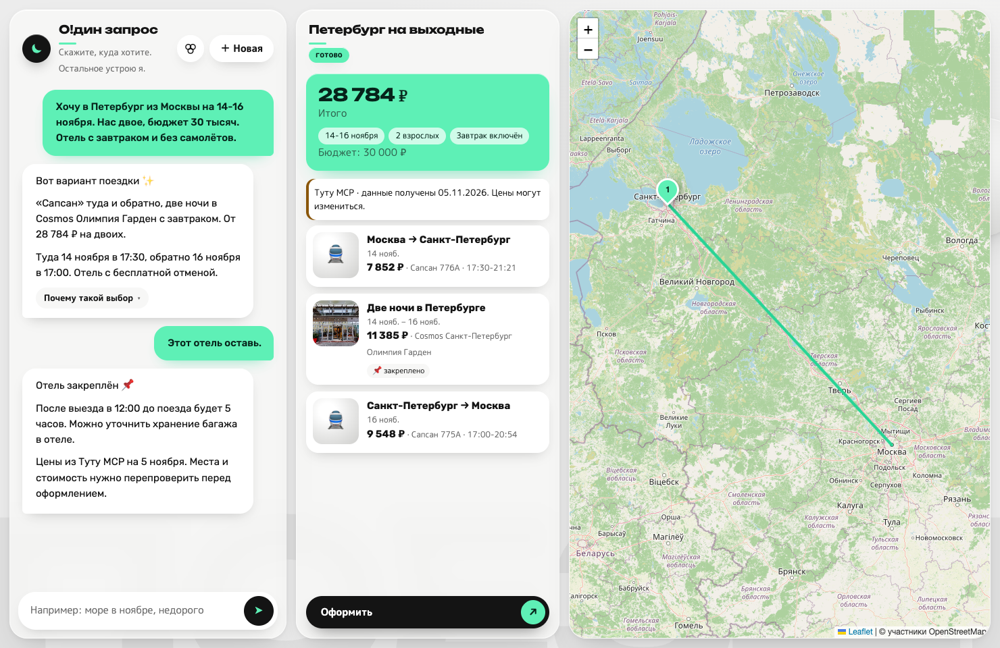
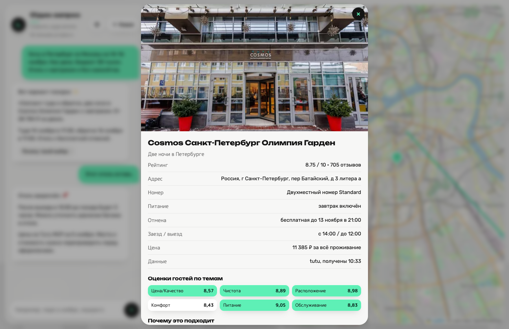
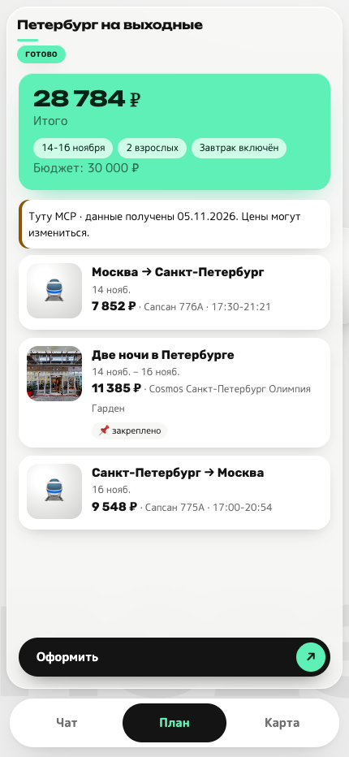
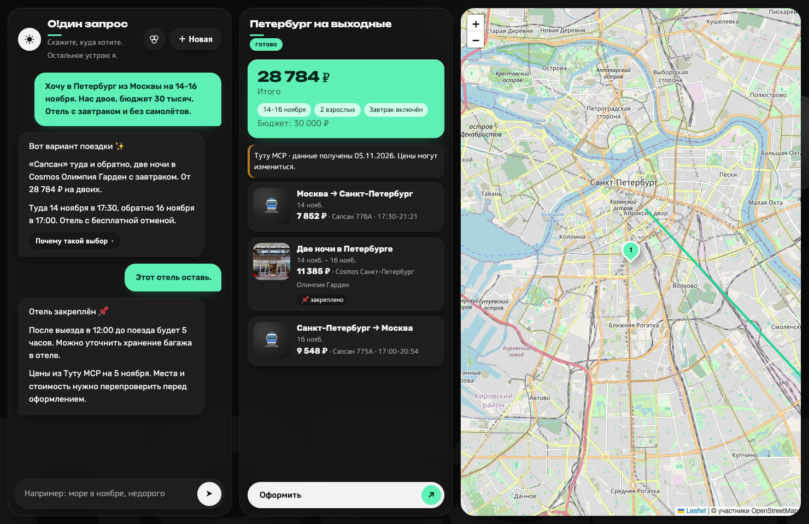
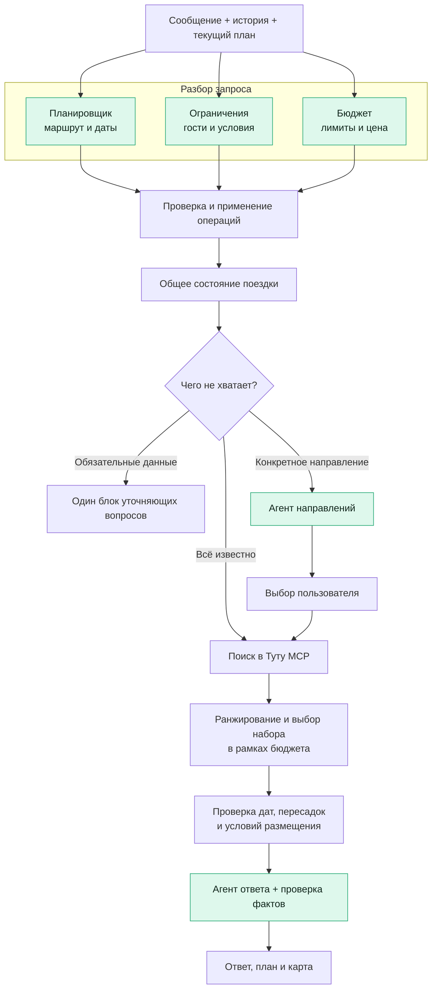
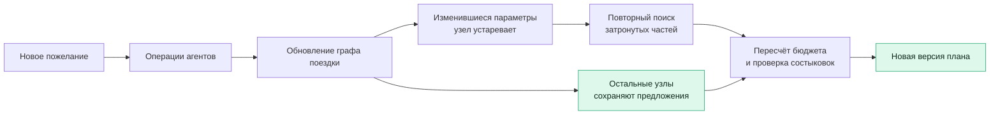
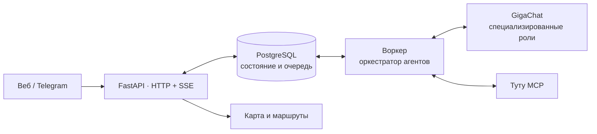

<div align="center">


<br>

**AI-агент для путешествий: отели, транспорт и маршрут под ваши условия.**

<p>
  
  
  
  
  
  
</p>

[Возможности](#возможности) · [Интерфейс](#интерфейс) · [Запуск](#быстрый-старт) · [Архитектура](#как-устроено)

</div>

## Возможности

Опишите поездку обычным сообщением. Агент уточнит недостающие условия, подберёт варианты и соберёт план с ценами и картой. Новые пожелания можно добавить в том же диалоге.

| | Что умеет |
| :--- | :--- |
| **Помогает выбрать направление** | Предлагает варианты по бюджету, сезону и пожеланиям, если вы ещё не решили, куда ехать. |
| **Подбирает проживание** | Учитывает питание, отмену, рейтинг, отзывы и условия размещения. Объясняет выбор и компромиссы. |
| **Собирает переезды** | Ищет самолёты, поезда и автобусы. Проверяет даты, пересадки и состыковки с проживанием. |
| **Показывает маршрут** | Объединяет чат, план и карту в одном интерфейсе. |
| **Меняет план в диалоге** | Пересчитывает затронутые части поездки. Позволяет закрепить понравившийся вариант. |
| **Использует прошлые поездки** | Сохраняет отзывы и предпочтения; позволяет собрать новую поездку из понравившихся прошлых. |

Веб-интерфейс адаптируется к телефону, поддерживает светлую и тёмную темы и работает как Telegram Mini App.

## Интерфейс

**Диалог, план и карта рядом.**



<table>
  <tr>
    <th width="73%">Карточка отеля: тариф, условия и оценки гостей</th>
    <th width="27%">План на телефоне</th>
  </tr>
  <tr>
    <td valign="top"></td>
    <td valign="top"></td>
  </tr>
</table>

<details>
<summary><b>Посмотреть тёмную тему</b></summary>



</details>

<sub>Интерфейс заполнен реальной выдачей Туту MCP от 5 ноября 2026 года: поездка на двоих 14-16 ноября, поезда «Сапсан» и Cosmos Санкт-Петербург Олимпия Гарден. Диалог составлен для иллюстрации. Цены и наличие могут измениться. [Источники скриншотов](docs/screenshots.md).</sub>

## Пример сценария

> **Вы:** Хочу в Петербург из Москвы на выходные. Нас двое, бюджет 30 тысяч. Отель с завтраком и без самолётов.
>
> **Агент:** Уточняет даты и собирает план: поезда, отель, общая стоимость и маршрут.
>
> **Вы:** Сдвинь поездку на два дня, этот отель оставь.
>
> **Агент:** Сохраняет выбор отеля, заново проверяет доступность и цены на новые даты, обновляет переезды и бюджет.

## Быстрый старт

Нужны **Docker с Compose** и собственный ключ **GigaChat API**. Команды выполняются из корня проекта.

```bash
cp .env.example .env
```

Впишите ключ в `.env`:

```dotenv
GIGACHAT_AUTH_KEY=ваш_ключ
```

```bash
docker compose up --build
```

Веб-интерфейс доступен на порту `8080`, документация API - по пути `/docs`. Миграции БД применяются автоматически. Без ключа приложение запускается, но агент не отвечает на сообщения.

<details>
<summary><b>Дополнительные настройки</b></summary>

| Переменная | Для чего |
| :--- | :--- |
| `HOTELS_SOURCE`, `TRANSPORT_SOURCE` | `auto` - Туту с переходом на помеченные демо-данные; `tutu` - только Туту; `mock` - только демо. |
| `TELEGRAM_BOT_TOKEN` | Токен собственного Telegram-бота. Для Mini App также нужен публичный HTTPS-адрес в `PUBLIC_BASE_URL`. |
| `DOCKER_PLATFORM` | `linux/arm64` для нативного запуска на Apple Silicon; по умолчанию `linux/amd64`. |
| `SESSION_SECRET` | Собственный случайный секрет для подписи сессий. |

Остальные параметры описаны в [.env.example](.env.example). Файл `.env` исключён из Git.

</details>

## Как устроено

### Роли агентов

Один запрос разбирают три специализированных агента: **планировщик**, **агент ограничений** и **агент бюджета**. Каждый получает сообщение, историю диалога и текущее состояние поездки, но возвращает изменения только в своей области.

Это отдельные роли GigaChat со своими промптами и схемами ответов. Их работой управляет оркестратор на Python; все роли используют общую модель.

| Агент | Ответственность | Результат |
| :--- | :--- | :--- |
| **Планировщик** · `planner` | Маршрут, даты, длительность, город отправления, закрепление выбранных вариантов | Изменения маршрута и дат, например `SetRoute`, `SetDates`, `PinOffer` |
| **Ограничения** · `constraints` | Состав гостей, дети, питомцы, питание, отмена, транспорт и приоритеты | Условия и их строгость: обязательное требование или пожелание |
| **Бюджет** · `budget` | Общий лимит, сумма на человека, бюджет жилья или транспорта, просьбы «дешевле» | Лимит расходов и изменения приоритета цены |
| **Направления** · `destinations` | Подбор, когда конкретный город ещё не выбран | До трёх направлений из подготовленных кандидатов с объяснением по фактам |
| **Ответ** · `answer` | Объяснение собранного плана, компромиссов и рисков | Текст на основе рассчитанных цен, выбранных предложений и проверок |
| **После оформления** · `aftersales` | Ранний заезд, трансфер, перенос дат и отмена в рамках демонстрационного заказа | Распознанное намерение для сценария сопровождения |

Агенты возвращают структурированные изменения. Код переводит их в типизированные операции, проверяет права каждой роли и применяет к общему состоянию `TripState`. Поиск, расчёт стоимости и проверка состыковок выполняются в Python.

### Как собирается ответ



Три роли разбора запускаются одной асинхронной группой. Фактическую параллельность ограничивает `GIGACHAT_MAX_CONCURRENCY`; при значении `1` вызовы модели выполняются по очереди.

Перед ответом код собирает факты и рекомендации. Текст модели проверяется на неподтверждённые числа и утверждения; при неудачной повторной попытке используется ответ по шаблону.

### Как меняется готовая поездка

Поездка хранится как граф проживаний и переездов со стабильными идентификаторами. Для каждого узла сохраняются параметры поиска, выбранное предложение и признак закрепления.



Например, «убери завтрак» меняет условия проживания и запускает повторный поиск отеля. Неизменившиеся билеты сохраняются. Если меняются даты, проверяются и проживание, и переезды; закреплённый вариант учитывается при подборе, а его доступность на новые даты проверяется заново.

### Сервисы и обмен данными



API принимает сообщения и ставит команды в очередь. Воркер запускает агентов, сохраняет версии плана и события. Интерфейс получает обновления через SSE. История поездок добавляет принятые пользователем предпочтения; пожелания текущей поездки имеют приоритет.

Подробнее: [оркестратор](backend/agents/runtime/orchestrator.py), [схемы ответов агентов](backend/agents/runtime/schemas.py), [операции и права ролей](backend/agents/domain/ops.py), [граф поездки](backend/agents/domain/graph.py).

## Источники и ограничения

| Данные | Источник |
| :--- | :--- |
| Отели, тарифы, отзывы; самолёты, поезда и автобусы | Туту MCP |
| Климат и температура моря | Open-Meteo, архивные данные |
| Геокодинг, дорожные маршруты и карта | Nominatim, OSRM, MapLibre / OpenFreeMap; резервный Leaflet |

В режиме `auto` недоступные предложения заменяются **демо-данными с явной пометкой**. Для выдачи без подстановок выберите режим `tutu`.

**Бронирование и оплата имитируются:** приложение не списывает деньги и не оформляет заказы у поставщиков.

## Разработка

```bash
python3 -m venv .venv
source .venv/bin/activate
pip install -r backend/requirements-dev.txt
make test
```

`make test-db` запускает тесты с временным PostgreSQL; для него нужен Docker.

| Каталог | Назначение |
| :--- | :--- |
| `backend/agents/` | Логика агентов, интеграции, корзина и веб-интерфейс |
| `backend/chat/` | API диалога, события и Telegram-бот |
| `backend/history/` | История, отзывы и предпочтения |
| `backend/trip_map/` | Карта, геокодинг и маршруты |
| `backend/shared/` | Общие модели, настройки и контракты |

[Контракт диалога](backend/chat/README.md) · [Карта](backend/trip_map/README.md) · [История поездок](docs/trip-templates.md) · [Сборка из прошлых поездок](docs/trip-blend.md)

---

<sub>Создан командой ekvivalentno на Ostrovok! Hackathon 2026, трек «О!дин запрос».</sub>
