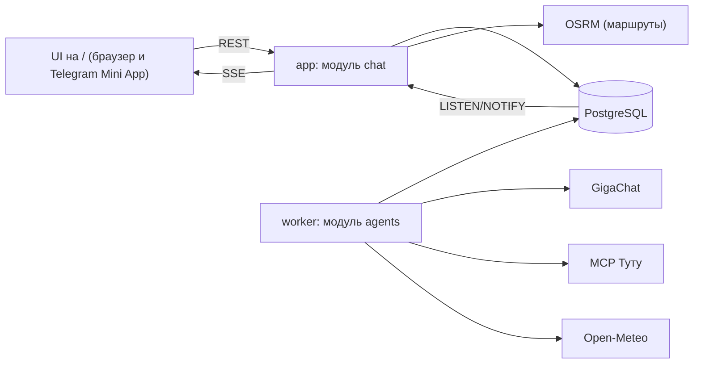

# План реализации: «О!дин запрос» (команда ekvivalentno)

Документ — спецификация для написания кода в `ostrovok-hackathon-2026/ekvivalentno`.
Всё, что выбрано мной по умолчанию, собрано в разделе 15. Поправьте там, где не согласны.

## 0. Зафиксированные решения

| Тема | Решение |
|---|---|
| Бэкенд | Один FastAPI-проект, модули `chat` и `agents`, один Docker-образ, два процесса: `app` (API + UI) и `worker` (агенты) |
| Состояние | PostgreSQL 16: очередь запусков, план с версиями, полный журнал операций, события для SSE с дочиткой |
| LLM | GigaChat через нативный API (OAuth). Ключ команда передаёт жюри |
| Данные | MCP Туту, живые данные. Моки только там, где Туту не отдаёт данные (например, Япония), с явной пометкой в JSON и UI |
| Агенты | Главный + 6 специалистов: направлений, ограничений, бюджета, отелей, переездов, проверки |
| Изменения плана | Не JSON Patch от LLM, а типизированные операции (раздел 3) |
| Объём v1 | Весь путь: вдохновение → выбор направления → подбор → сравнение → сборка → корзина → имитация оплаты, плюс пересборка |
| Фронтенд | Один статический UI на `/` (развитие `trip_map`), он же открывается как Telegram Mini App |
| Telegram | Бот через BotFather (делает команда), HTTPS через cloudflared quick tunnel в отдельном compose-профиле |
| Карта | Дороги (трансферы, авто) — по OSRM. ЖД/автобус — по координатам станций из MCP, если они есть, иначе прямая. Самолёт — дуга |
| Обязательные сценарии | Москва и Петербург; поездка по нескольким городам России. Япония — проверить покрытие Туту, иначе моки с пометкой |

## 1. Архитектура



### Очередь и запуски (`agent_runs`)

- `POST /messages` сохраняет сообщение, создаёт `agent_runs(status=queued)` и возвращает `202`.
- Worker забирает задачу через `SELECT … FOR UPDATE SKIP LOCKED`. Условие: в этом чате нет запуска в `running` (защищено частичным уникальным индексом по `chat_id` для `running`).
- Жизненный цикл: `queued → running → (waiting_user | done | failed)`. `waiting_user` освобождает очередь чата.
- Сообщения одного чата обрабатываются строго по порядку. Новое сообщение во время поиска ждёт в `queued`.
- Heartbeat раз в 10 с. Запуск без heartbeat дольше 60 с возвращается в `queued`.
- Контрольные точки: после каждого шага агента результат пишется в `agent_runs.checkpoint`, после рестарта worker продолжает с последнего шага. Ответы MCP кэшируются в `offers`, поэтому повтор дешёвый.
- Идемпотентность: `client_message_id` от фронта, уникальный в пределах чата.

### События

- Worker пишет строку в `chat_events` (`seq` — bigserial) и делает `NOTIFY chat_events, '<chat_id>'` в той же транзакции.
- API слушает `LISTEN` и раздаёт подписчикам SSE.
- При переподключении клиент шлёт `Last-Event-ID`, и API дочитывает `seq > id` из БД.
- Типы событий: `request.queued`, `agent.progress`, `clarification.required`, `destinations.ready`, `plan.updated`, `plan.ready`, `assistant.message`, `cart.updated`, `order.paid`, `request.failed`.
- Каждое событие плана несёт `plan_id`, `revision` и `changed_node_ids`. Фронт сам дозагружает версию плана.

## 2. Агенты

Во всех агентах числа, даты, суммы, часовые пояса и проверки считает **код**. LLM решает только то, что требует понимания языка.

| Агент | LLM | Код | Пишет операции |
|---|---|---|---|
| **Главный** | Понимание сообщения (новая поездка / изменение / выбор / вопрос), декомпозиция маршрута, решение, что спросить, финальный ответ с «почему» | Выбор специалистов по графу зависимостей, сборка фактов для ответа, сверка текста с JSON | Структура: места, узлы, порядок, даты, вопросы, закрепления |
| **Направлений** | Ранжирование кандидатов под пожелания и формулировка причин | Фильтр каталога по климату (Open-Meteo), времени в пути, тегам; пробные цены через Туту | `set_destination_candidates` |
| **Ограничений** | Извлечение состава, обязательных условий, запретов и приоритетов с цитатами | Нормализация (возраст детей, питомцы), определение затронутых узлов | `set_party`, `add_constraint`, `remove_constraint`, `set_priorities` |
| **Бюджета** | Трактовка бюджета («до 30 тысяч за всё», «недорого»), стратегия экономии | Пересчёт цены за ночь и за всё, полная стоимость, оптимизация набора предложений под бюджет | `set_budget`, `select_offer` (при оптимизации) |
| **Отелей** | Только для мягких пожеланий, которых нет в фильтрах MCP («тихо», «рядом с центром»): оценка по описанию | Параметры `search_hotels`, `get_offer_details`, фильтр жёстких условий на уровне тарифа, скоринг | `attach_options` для узлов `stay` |
| **Переездов** | Нет | Поиск авиа/ЖД/автобусов через MCP, сегменты, время, трансферы (OSRM) | `attach_options` для `transport`/`transfer`, `ensure_transfer` |
| **Проверки** | Нет | Правила состыковок и условий (раздел 6) | `set_checks` |

Параллельно запускаются только независимые шаги: ограничения ‖ бюджет, отели ‖ переезды. Все вызовы GigaChat идут через семафор `GIGACHAT_MAX_CONCURRENCY`, его значение берём по реальным лимитам аккаунта.

### Цикл обработки одного сообщения

```text
1. Главный: классификация сообщения и черновик операций структуры
2. Ограничения ‖ Бюджет: операции своих областей
3. PlanService.apply → новая ревизия → граф зависимостей помечает stale-узлы
4. Блокирующие пробелы? → Главный формирует ОДИН вопрос (можно с вариантами) → waiting_user
5. Направление не выбрано? → Агент направлений → 3 карточки → waiting_user (выбор)
6. Отели ‖ Переезды: только stale-узлы и узлы без вариантов
7. Бюджет: выбор набора предложений (с учётом закреплённых)
8. Проверка: правила состыковок; error → шаг 6 для затронутых узлов (не больше 2 итераций)
9. Главный: ответ (раздел 4) → сверка текста с JSON → assistant.message + plan.ready
```

## 3. Типизированные операции вместо JSON Patch

LLM не пишет пути вида `/nodes/stay_tokyo/check_in`. Агент возвращает список операций из закрытого набора. Это Pydantic discriminated union по полю `op`, и каждая операция валидируется отдельно.

```json
{
  "base_revision": 6,
  "ops": [
    {"op": "set_dates", "node_id": "stay_spb", "check_in": "2026-11-16", "check_out": "2026-11-18",
     "source": {"message_id": "m12", "quote": "а если на два дня позже"}},
    {"op": "add_constraint", "id": "pets", "kind": "pets_allowed", "value": {"type": "dog"},
     "strength": "hard", "source": {"message_id": "m13", "quote": "с нами едет собака"}}
  ]
}
```

Набор операций:

| Группа | Операции |
|---|---|
| Поездка | `set_scope`, `set_origin`, `set_party`, `set_budget`, `set_priorities` |
| Условия | `add_constraint`, `remove_constraint`, `relax_constraint` (только после согласия пользователя) |
| Граф | `add_place`, `add_node`, `remove_node`, `update_node`, `set_dates`, `reorder`, `ensure_transfer` |
| Предложения | `attach_options`, `select_offer`, `pin_offer`, `unpin_offer` |
| Диалог | `ask`, `resolve_question`, `set_destination_candidates`, `choose_destination` |
| Проверка | `set_checks` |

`PlanService.apply(agent, base_revision, ops)` выполняется в одной транзакции:

1. **Права:** агент может использовать только свои операции (таблица в разделе 2).
2. **Версия:** если `base_revision` устарела, операции, затрагивающие изменённые после неё поля, отклоняются, остальные применяются.
3. **Применение** к Pydantic-модели `TripState` и проверка инвариантов: ссылки на места, `check_out > check_in`, порядок, валюта.
4. **Зависимости** (код, не LLM): какие узлы стали `stale`.
5. **Запись:** `trip_plans` (новые `state_json` и `view_json`), снимок в `trip_plan_versions`, каждая операция в `plan_operations` (кто, когда, `base_revision`, цитата), событие `plan.updated`.

Если LLM вернул невалидные операции: один повтор с текстом ошибки валидации, после этого — `request.failed` с понятной причиной.

### Правила зависимостей

| Изменение | Что становится stale | Что делаем |
|---|---|---|
| Даты узла | Этот узел, соседние переезды, следующие проживания, если сдвиг каскадный | Новый поиск по затронутым узлам |
| Состав группы | Все узлы с ценой | Новый поиск (вместимость номеров, число билетов) |
| Бюджет | Ничего | Перевыбор из имеющихся вариантов; поиск, только если ни один не проходит |
| Жёсткое условие добавлено | Узлы, где у выбранного варианта условие `fail` или `unknown` | Перефильтровать варианты, при нехватке — поиск |
| Жёсткое условие снято | Ничего | Расширить поиск (могут найтись варианты дешевле) |
| Приоритеты | Ничего | Только пересортировка |
| Закреплённое предложение (`pin`) | Не трогается | Если нарушает новое жёсткое условие — вопрос пользователю |

## 4. Что отдаём: ответ главного агента и JSON для фронта

Каждый запуск даёт **пару, привязанную к одной ревизии**:

- `chat_messages` — ответ главного агента (`AgentTurn`), с `plan_revision`;
- `trip_plans.view_json` — данные для карты, карточек и корзины этой же ревизии.

### 4.1 Ответ главного агента (`AgentTurn`)

Главный агент получает **пакет фактов**, собранный кодом: выбранные предложения, критерии скоринга, разницу с альтернативами, результаты проверок, изменения с прошлой ревизии. Писать можно только по этим фактам.

```json
{
  "plan_revision": 7,
  "kind": "plan | question | destinations | change | checkout",
  "text": "Собрал поездку в Петербург на 14–16 ноября для двоих…",
  "understood": [
    {"field": "dates", "value": "14–16 ноября", "origin": "user"},
    {"field": "origin", "value": "Москва", "origin": "user"},
    {"field": "budget", "value": "до 40 000 ₽ за всю поездку", "origin": "user"}
  ],
  "recommendations": [
    {
      "node_id": "stay_spb",
      "offer_id": "off_7649055_r2",
      "why": ["Завтрак и бесплатная отмена до 13 ноября 15:00", "9,05/10 по 596 отзывам", "550 м до метро"],
      "tradeoffs": [
        {"vs_offer_id": "off_7652103_r1", "text": "На 870 ₽ дороже New City Inn, но рейтинг выше на 1,1"}
      ],
      "risks": ["Заселение с 14:00, поезд приходит в 07:10 — нужен ранний заезд или камера хранения"]
    }
  ],
  "changes": [
    {"node_id": "stay_spb", "before": "Rosso Riva, 19 259 ₽", "after": "Cosmos Smart, 17 265 ₽", "delta": "-1994.00"}
  ],
  "questions": [],
  "quick_replies": ["Дешевле", "На 2 дня позже", "Добавить взрослого", "Оформить"]
}
```

Шаблон текста ответа:

1. **Что понял** — одна строка; предположения помечены.
2. **Что предлагаю** — итог: маршрут, даты, сумма и полнота расчёта.
3. **Почему** — по приоритетам этого пользователя, 2–3 пункта на ключевой узел.
4. **Чем пожертвовали** — сравнение с ближайшей альтернативой в цифрах.
5. **Риски** — предупреждения проверки, непроверенные условия, моковые данные, неполнота поиска.
6. **Что изменилось** — только при пересборке: было → стало, разница в цене.
7. **Следующий шаг** — один вопрос или быстрые ответы.

Сверка кодом перед отправкой: каждая сумма, дата и название отеля в `text` должны быть в пакете фактов. При расхождении — одна перегенерация, затем ответ по шаблону без LLM.

### 4.2 JSON для фронта (`view_json`)

Совместим с текущей схемой `trip_map` (`places` + `nodes` + `sequence` + `offers`) и расширяет её.

```json
{
  "schema_version": 2,
  "plan_id": "…", "revision": 7,
  "status": "draft | searching | needs_input | choosing_destination | ready | partial | in_cart | booked",
  "title": "Петербург, 14–16 ноября",
  "trip": {"kind": "city | multi_city", "origin": "msk", "date_from": "2026-11-14", "date_to": "2026-11-16",
           "party": {"adults": 2, "children_ages": [], "pets": []}},
  "budget": {"amount": "40000.00", "currency": "RUB", "scope": "trip"},
  "pricing": {"known_subtotal": "35120.00", "total": "35120.00", "is_complete": true,
              "missing": [], "within_budget": true},
  "priorities": [{"key": "price", "weight": 0.4, "origin": "user", "quote": "недорого"}],
  "constraints": [{"id": "breakfast", "strength": "hard", "label": "Завтрак"}],
  "places": {"spb": {"name": "Санкт-Петербург", "lat": 59.94, "lon": 30.31, "tz": "Europe/Moscow"}},
  "sequence": ["outbound", "transfer_in", "stay_spb", "return"],
  "nodes": {
    "stay_spb": {
      "type": "stay", "status": "selected | options | stale | searching | not_found",
      "place": "spb", "check_in": "2026-11-14", "check_out": "2026-11-16",
      "selected_offer_ref": "off_7649055_r2", "pinned": false,
      "options": [
        {"offer_id": "off_7649055_r2", "rank": 1, "score": 0.82,
         "criteria": {"price": 0.71, "rating": 0.9, "location": 0.8, "cancellation": 1.0, "meal": 1.0},
         "constraints": {"breakfast": "pass", "free_cancellation": "pass", "pets_allowed": "unknown"}}
      ]
    },
    "outbound": {
      "type": "transport", "mode": "rail", "from": "msk", "to": "spb",
      "selected_offer_ref": "off_rail_…",
      "geometry": {"type": "LineString", "coordinates": [[37.65, 55.77], [30.36, 59.93]]},
      "geometry_status": "routed | stations | straight | great_circle"
    }
  },
  "offers": {
    "off_7649055_r2": {
      "kind": "hotel_rate", "source": "tutu_mcp", "data_mode": "live | mock",
      "retrieved_at": "2026-10-27T15:02:11Z",
      "hotel": {"name": "Cosmos Smart Москва Дубининская", "stars": 3, "rating": 9.05, "review_count": 596,
                "address": "…", "lat": 55.72, "lon": 37.63, "photos": [], "amenities": [],
                "check_in_time": "14:00", "check_out_time": "12:00"},
      "rate": {"room_name": "Стандартный, двуспальная кровать", "meal": "breakfast",
               "free_cancellation_until": "2026-11-13T12:00:00Z",
               "price": {"amount": "17265.00", "currency": "RUB", "basis": "stay_total"}}
    }
  },
  "checks": [
    {"code": "EARLY_ARRIVAL", "severity": "warning", "node_ids": ["outbound", "stay_spb"],
     "facts": {"arrival_local": "2026-11-14T07:10+03:00", "check_in_time": "14:00", "wait_hours": 6.3},
     "suggestion": "Ранний заезд или хранение багажа"}
  ],
  "changes": {"from_revision": 6, "changed_node_ids": ["stay_spb"]},
  "questions": [{"id": "q3", "text": "Откуда выезжаете?", "options": ["Москва", "Санкт-Петербург"], "field": "origin"}],
  "destination_candidates": [],
  "cart": {"status": "empty | draft | checked | paid", "items": [], "total": null},
  "data_notes": [{"scope": "stay_tokyo", "kind": "mock", "text": "Синтетические данные: Туту не отдаёт отели Японии"}]
}
```

Деньги хранятся строкой-десятичным числом. Координаты в `geometry` идут в порядке GeoJSON `[lon, lat]`; если координат нет, пишем `null`, а не центр города.

## 5. Сравнение и ранжирование (код)

1. **Жёсткие условия** фильтруют на уровне тарифа (`pass` / `fail` / `unknown`). `unknown` не считается выполнением: вариант остаётся только с пометкой риска и, если других нет, с вопросом пользователю.
2. **Скоринг:** `score = Σ weight_i · criterion_i`, все критерии нормированы в 0..1:
   - отели: цена, рейтинг (с поправкой на число отзывов), расстояние до центра или точки интереса, гибкость отмены, питание, звёзды;
   - транспорт: цена, время в пути, число пересадок, удобство времени отправления и прибытия, багаж.
3. **Веса:** сначала по умолчанию, затем их корректирует агент ограничений по словам пользователя («недорого» → цена ↑, «с ребёнком» → питание и время в пути ↑, «без долгих перелётов» → время в пути ↑ плюс жёсткий лимит).
4. **Компромиссы:** для выбранного варианта код считает разницу по каждому критерию с двумя ближайшими альтернативами. Это и есть факты для «чем пожертвовали».
5. **Бюджет:** выбор набора предложений по всем узлам — максимум суммарного score при `total ≤ budget`. Перебор с отсечением: вариантов ≤ 10 на узел, узлов ≤ 8. Закреплённые предложения фиксированы.

## 6. Правила состыковок (агент проверки)

Все времена хранятся с часовым поясом. Пояс места определяется по координатам (`timezonefinder`, офлайн), сравнения идут в UTC, показ — в местном времени.

| Код | Правило | Уровень |
|---|---|---|
| `DATES_STAY_ARRIVAL` | `check_in` проживания = дата прибытия входящего переезда (местное время) | error |
| `DATES_STAY_DEPARTURE` | `check_out` = дата отправления исходящего переезда | error |
| `NIGHTS_COVERAGE` | Каждая ночь поездки покрыта проживанием или ночным переездом; без пересечений проживаний | error |
| `PLACE_CHAIN` | `transport.to` совпадает с местом следующего проживания (или с вложенным в него местом); иначе нужен `transfer` | error |
| `MISSING_TRANSFER` | Аэропорт или вокзал прибытия ≠ отель, а трансфера нет → `ensure_transfer` | warning |
| `EARLY_ARRIVAL` | Прибытие + трансфер раньше `check_in_time` больше чем на 3 ч | warning |
| `NIGHT_ARRIVAL` | Прибытие + трансфер с 00:00 до 06:00: ночь до заезда не оплачена или отель без круглосуточной стойки | warning |
| `LATE_CHECKIN` | Прибытие + трансфер после 23:00, круглосуточная стойка не подтверждена | warning |
| `LATE_DEPARTURE_GAP` | Между `check_out_time` и выездом в аэропорт/на вокзал больше 4 ч | info |
| `DEPARTURE_BUFFER` | Выезд из отеля = отправление − трансфер − буфер (авиа: 2 ч внутр. / 3 ч междунар.; ЖД: 30 мин; автобус: 20 мин); результат раньше 05:00 → предупредить | warning |
| `CONNECTION_TIME` | Пересадка: авиа, тот же аэропорт ≥ 60 мин (внутр.) / 90 мин (междунар.); смена аэропорта или вокзала ≥ трансфер + 90 мин | error |
| `TZ_DATE_SHIFT` | Дата прибытия в местном времени отличается от даты отправления (перелёты на восток, ночные поезда) — проверить даты проживания | info |
| `PARTY_CAPACITY` | Вместимость номеров ≥ состав группы; число билетов = число путешественников; возраст детей известен там, где влияет на тариф | error |
| `BUDGET` | Итог ≤ бюджет нужной области; при неполном расчёте — `is_complete=false`, а не «укладывается» | error / warning |
| `CANCELLATION_EXPIRED` | Срок бесплатной отмены уже прошёл | warning |
| `OFFER_STALE` | `retrieved_at` старше 30 мин → перепроверить перед корзиной | info, перед оплатой — error |
| `CONSTRAINT_UNKNOWN` | Жёсткое условие со статусом `unknown` у выбранного варианта | warning |

Ошибки (`error`) не дают статус `ready`: главный агент отправляет затронутые узлы на повторный подбор (не больше 2 итераций), затем честно показывает, что не сходится. Предупреждения идут в «Риски».

## 7. Агент направлений

- **Каталог** `data/destinations.yaml`, около 30 направлений:
  - Россия: Москва, Петербург, Казань, Сочи, Калининград, Минводы, Мурманск, Иркутск/Байкал, Алтай, Дагестан, Владивосток…
  - Зарубеж: Анталья, Хургада, Шарм-эль-Шейх, Дубай, Пхукет, Нячанг, Шри-Ланка, Мальдивы, Тбилиси, Ереван, Самарканд, Токио/Осака/Киото…
  - Поля: координаты, IATA/станции, теги (море, горы, город, дети, гастро), справочное время в пути из Москвы, визовый режим для граждан РФ. Справочные поля помечаются как статичные.
- **Климат:** Open-Meteo. Среднемесячные температура воздуха и осадки — по архиву за прошлые годы; температура моря — по Marine API. Кэш в `climate_cache`.
- **Пайплайн:** жёсткие фильтры кодом (месяц, «тёплое море» → вода ≥ 24 °C, «без долгих перелётов» → ≤ 5 ч) → LLM выбирает 3 кандидата и пишет причины → пробная цена через Туту (минимальный отель на типовой срок, перелёт, если есть) → карточки: почему, погода, время в пути, ориентир по цене, источник цены (`live` / `mock`).
- Пользователь выбирает карточку → `choose_destination` → главный агент декомпозирует поездку.

## 8. Корзина и имитация покупки

- Корзина строится из выбранных предложений текущей ревизии: `POST /plans/{id}/cart`.
- `POST /cart/{id}/check`:
  - перепроверяет цены и наличие через MCP (`get_offer_details` для отелей, повторный поиск для транспорта);
  - запускает все проверки, включая `OFFER_STALE`;
  - показывает изменения цен; ошибки проверки блокируют оплату.
- `POST /cart/{id}/checkout`: форма гостя (ФИО, email; данные никуда не уходят) → «Оплатить» → имитация платежа → `orders(status=paid_mock, number=EKV-XXXXXX)` → план `booked` → событие `order.paid`.
- Инструменты Туту, которые создают корзины или заказы (`register_checkout_passengers`, создание ссылок checkout), **не вызываем**. Адаптер MCP пропускает только инструменты из белого списка (только чтение). По инструкции Туту авиа-регистрация создаёт реальный неоплаченный заказ, поэтому запрет жёсткий.

## 9. MCP Туту и прочие источники

- `agents/integrations/tutu_mcp.py`: клиент MCP по streamable HTTP с сессией, таймаутами и ретраями, белым списком инструментов.
- Известные по чату инструменты: `search_hotels`, `get_offer_details`, `get_hotels_instructions`, `fetch_resource`, `get_rail_seatmap`. Имена транспортных инструментов и их схемы снимаем на этапе 0.
- Нормализация в `offers`: база цены (за ночь / за всё / на человека), валюта, время с поясом, условия отмены, `retrieved_at`, сырой ответ.
- Учтено из прошлого запуска:
  - `price_max` в `search_hotels` задаётся за ночь;
  - завтрак и отмена проверяются на уровне тарифа;
  - для детализации нужен `hotel_id`, а не `tutu_offer_id`.
- **Сеть:** `mcp.tutu.ru` и `tutu.ru` с зарубежного IP не проходят TLS-рукопожатие (проверено 27.10 с финского IP). Разработка, демо и запуск жюри — с российского IP, без VPN.
- Моки только для того, что Туту не отдаёт: `mocks/` с пометкой `data_mode: "mock"`. Подмешивать моки к живым данным без пометки нельзя.
- Для тестов — записанные ответы MCP и GigaChat (`tests/fixtures/`), в демо они не используются.

## 10. GigaChat

- `agents/integrations/llm.py`: официальный Python-клиент GigaChat, авторизация по ключу → OAuth-токен, автообновление.
- Структурированный ответ по JSON Schema (операции раздела 3), затем повторная проверка Pydantic.
- На этапе 0 проверить:
  - доступные модели аккаунта;
  - лимит параллельных запросов (→ `GIGACHAT_MAX_CONCURRENCY`);
  - нужен ли корневой сертификат НУЦ Минцифры в образе для TLS;
  - справляется ли модель с нашей схемой операций (размер схемы, вложенность).
- Промпты лежат в `agents/runtime/prompts/*.md`. Основа — промпты из чата: главный с декомпозицией и специалисты с общим контрактом. Отличие: на выходе типизированные операции, а не JSON Patch.

## 11. HTTP API

| Метод и путь | Назначение |
|---|---|
| `GET /` | UI (браузер и Mini App) |
| `GET /health` | 200 `{"status":"ok"}` |
| `GET /ready` | Доступность БД; GigaChat и MCP показываются как `degraded` |
| `POST /api/v1/auth/telegram` | Проверка `initData` (HMAC по токену бота) → сессия |
| `POST /api/v1/auth/guest` | Гостевая сессия для `localhost:8080` (cookie) |
| `POST /api/v1/chats` | Новый чат |
| `GET /api/v1/chats/{id}/messages` | История |
| `POST /api/v1/chats/{id}/messages` | Сообщение → `202` (`client_message_id` для идемпотентности) |
| `POST /api/v1/chats/{id}/clarifications/{qid}/answers` | Ответ кнопкой |
| `POST /api/v1/chats/{id}/destinations/{key}/choose` | Выбор направления |
| `POST /api/v1/plans/{id}/nodes/{node}/select` | Выбор альтернативы вручную (= `select_offer` + `pin_offer`) |
| `GET /api/v1/chats/{id}/events` | SSE с `Last-Event-ID` |
| `GET /api/v1/chats/{id}/plan` | Актуальный `view_json` |
| `GET /api/v1/plans/{id}/versions/{rev}` | Конкретная ревизия |
| `POST /api/v1/plans/{id}/cart`, `POST /api/v1/carts/{id}/check`, `POST /api/v1/carts/{id}/checkout` | Корзина и имитация оплаты |
| `GET /trip-map/api/route` | Дорожный маршрут (из `trip_map`) |

## 12. База данных

| Таблица | Содержимое |
|---|---|
| `users` | Telegram id или гость |
| `chats` | Владелец, активный план |
| `chat_messages` | Роль, текст, `AgentTurn` (jsonb), `plan_revision`, `client_message_id` |
| `agent_runs` | Очередь: статус, heartbeat, checkpoint, ошибка |
| `trip_plans` | `state_json`, `view_json`, `revision`, `status` |
| `trip_plan_versions` | Снимки по ревизиям |
| `plan_operations` | Журнал операций: агент, `base_revision`, `op` (jsonb), источник, результат (применена / отклонена) |
| `clarifications` | Вопрос, поля, варианты, ответ |
| `offers` | Нормализованное предложение, сырой ответ, `source`, `data_mode`, `retrieved_at` |
| `carts`, `orders` | Корзина и имитированный заказ |
| `chat_events` | `seq` bigserial, тип, payload |
| `climate_cache`, `route_cache` | Кэши Open-Meteo и OSRM |

Миграции — Alembic, применяются автоматически при старте `app`.

## 13. Фронтенд (`/`, он же Mini App)

Развитие `backend/trip_map/static`, vanilla JS, без сборки.

- **Раскладка:** чат + карта + маршрут; на телефоне карта сверху, чат снизу листом.
- **Чат:**
  - сообщения с блоками «Почему / Чем пожертвовали / Риски / Что изменилось»;
  - быстрые ответы и кнопки вариантов в вопросах;
  - строка прогресса из `agent.progress`.
- **Карточки узлов:**
  - выбранный вариант и альтернативы с бейджами условий (`pass` / `fail` / `unknown`) и ручным выбором;
  - предупреждения проверки на узле;
  - бейдж `mock` у синтетических данных.
- **Карточки направлений:** погода, время в пути, ориентир цены, кнопка «Выбрать».
- **Корзина:** позиции, итог, проверка цен, форма, «Оплатить», экран заказа.
- **Telegram:** если есть `window.Telegram.WebApp` — `initData` → `/auth/telegram`, тема из `themeParams`, `MainButton` для «Оформить». Иначе гостевая сессия.
- **Безопасность:** данные плана вставляются только через `textContent` (как уже сделано в `trip_map`).

## 14. Запуск и требования правил

- **`docker-compose.yml`:**
  - `db`: `postgres:16.x-alpine`, версия зафиксирована, с healthcheck;
  - `app`: `8080:8080`, `depends_on: db (healthy)`, healthcheck на `/health`;
  - `worker`: тот же образ, команда `python -m app.agents.worker`;
  - `tunnel`: профиль `telegram`, cloudflared quick tunnel → `app:8080`. URL печатается в логах, его прописывают в BotFather.
- **`Dockerfile`:** multi-stage, `python:3.12-slim` (версия зафиксирована), непривилегированный пользователь, `platform: linux/amd64` в compose, зависимости с точными версиями.
- **`.env.example`:** `DATABASE_URL`, `GIGACHAT_AUTH_KEY=`, `GIGACHAT_SCOPE`, `GIGACHAT_MODEL`, `GIGACHAT_MAX_CONCURRENCY`, `TUTU_MCP_URL=https://mcp.tutu.ru/mcp`, `TELEGRAM_BOT_TOKEN=`, `TRIP_MAP_*`.
- **`README.md`** по шаблону организаторов: описание, видео, быстрый старт, переменные, маршруты, сценарии демо, что живое и что моковое, требование российского IP для MCP.
- **Makefile:** `up`, `down`, `logs`, `test`, `tunnel`.
- **Сдача:** логи в stdout, ветка `feature/trip-map-module` влита в `main`, тег `submission` на последнем коммите `main`, видео открывается в инкогнито.

## 15. Принято по умолчанию (поправьте, если не так)

- Город отправления не подставляется: если нужен транспорт, спрашиваем вместе с другими блокирующими вопросами одним сообщением.
- Свежесть предложения — 30 минут, перед оплатой — обязательная перепроверка.
- Буферы до отправления: авиа 2 ч внутр. / 3 ч междунар., ЖД 30 мин, автобус 20 мин. Минимальная пересадка: 60 / 90 мин.
- «Тёплое море» = вода ≥ 24 °C; «без долгих перелётов» = ≤ 5 ч, если пользователь не назвал своё число.
- Язык интерфейса и ответов — русский.
- Данные формы оплаты не валидируются как настоящие и никуда не отправляются.
- Отдельный агент направлений вызывается, только если направление не названо или названо слишком широко («к морю», «в Азию»).

## 16. Порядок работ

| # | Этап | Готово, когда |
|---|---|---|
| 0 | Проверка источников с российского IP: список инструментов MCP и их схемы, покрытие Москвы/Петербурга (отели, ЖД, авиа), координаты станций в сегментах, Япония; GigaChat: ключ, модель, лимиты, сертификат | `docs/sources.md` с реальными ответами и решением по Японии |
| 1 | Скелет: compose (`db`, `app`, `worker`, `tunnel`), Dockerfile, Alembic, `/health`, `/ready`, README, Makefile, слияние `trip_map` в `main` | `docker compose up --build` → `localhost:8080` открывает карту из примера |
| 2 | Контракты: `TripState`, операции, `view_json`, `AgentTurn`, события; примеры JSON для 5 сценариев | Примеры проходят валидацию, фронт рисует их без бэкенда |
| 3 | `PlanService`: права, версии, инварианты, зависимости, журнал | Юнит-тесты на все правила зависимостей и конфликты ревизий |
| 4 | Чат, очередь, worker, SSE с дочиткой, гостевая сессия | Дубль сообщения не создаёт запуск; рестарт worker продолжает задачу; SSE дочитывает пропущенное |
| 5 | Адаптеры MCP и GigaChat, нормализация, фикстуры | Живой поиск Москвы через адаптер совпадает с ручным прогоном из чата |
| 6 | Главный агент, ограничения, бюджет, вопросы | Полный запрос — 0 вопросов; неполный — 1 сообщение с вопросами |
| 7 | Отели, переезды, скоринг, оптимизация бюджета | Варианты со скорингом и `pass`/`fail`/`unknown` по условиям |
| 8 | Агент проверки: все правила раздела 6 | Тест на каждое правило; ночной прилёт и пересадки ловятся |
| 9 | Ответ главного агента + сверка с JSON | Нет ни одного числа в тексте, которого нет в фактах |
| 10 | Пересборка: дешевле, ±дни, +взрослые, собака, «оставь этот отель» | Незатронутые узлы не меняются, есть блок «Что изменилось» |
| 11 | Агент направлений, каталог, Open-Meteo | «Тёплое море в ноябре с ребёнком» → 3 карточки с погодой и ценой |
| 12 | Корзина и имитация оплаты | Путь от первого сообщения до `EKV-…` |
| 13 | Фронт: чат, карточки, альтернативы, корзина, направления (параллельно с 5–12 на примерах из этапа 2) | Все сценарии кликаются в браузере |
| 14 | Карта: геометрия ЖД по станциям, авто/трансфер через OSRM, иначе прямая | `geometry_status` заполнен у каждого переезда |
| 15 | Telegram: `initData`, тема, `MainButton`, профиль `tunnel` | Mini App открывается из бота и проходит сценарий |
| 16 | Метрики (доп.): набор из 20–30 тестовых запросов, доля доведённых до конца, число уточнений, время до первой рекомендации, ошибки состыковок; видео; тег `submission` | Отчёт метрик в README, тег поставлен |

## 17. Сценарии приёмки

1. «Найди отели в Москве на 6–9 ноября для двух взрослых, завтрак и бесплатная отмена, до 30 000 за всё» — без вопросов, только проживание, без транспорта.
2. «Хочу в Питер на выходные» — один вопрос (откуда и какие выходные), затем поезд + отель + трансферы.
3. «Хочу куда-нибудь к тёплому морю в ноябре, недорого, с ребёнком, без долгих перелётов» — один вопрос (откуда, возраст ребёнка), 3 направления, выбор, план.
4. «Москва → Казань → Нижний Новгород, 7 дней, двое» — граф из нескольких городов, состыковки.
5. Пересборка поверх 2 и 4: «а если на два дня позже», «сделай дешевле», «с нами едет собака», «нас будет четверо», «оставь этот отель».
6. Покупка: корзина → перепроверка цены → имитация оплаты → номер заказа.
7. Токио + Осака — живые данные или моки с пометкой.
8. MCP недоступен — понятная ошибка, план не портится.
