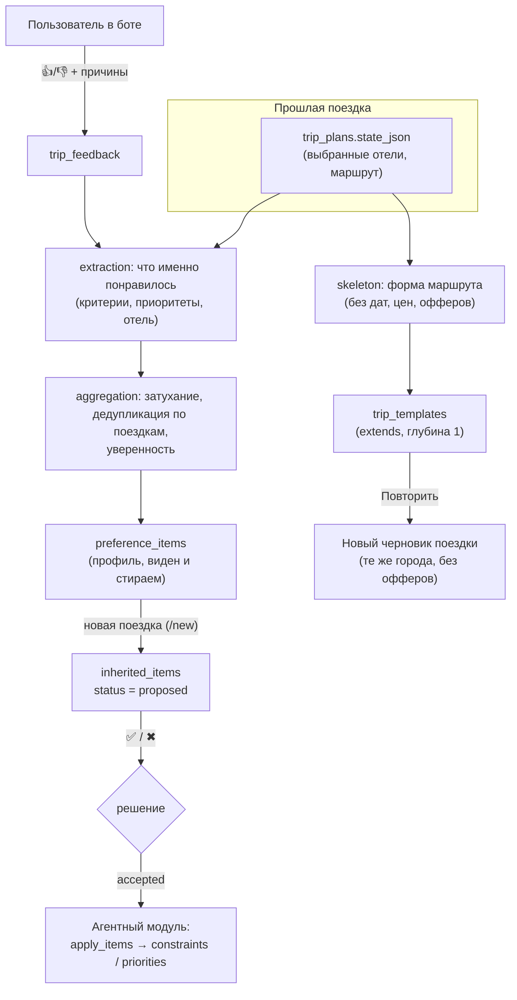

# История поездок, шаблоны и наследование

Экран «смешать прошлые поездки в новую»: [trip-blend.md](trip-blend.md).

Модуль `backend/history`. Идея: пользователь оставляет отзыв о поездке, а при планировании новой мы предлагаем то, что ему нравилось раньше. Технически это шаблоны в конфиге поездки и их слияние в новый план. Документ описывает дизайн, схему, контракт с агентной командой и содержит жёсткое ревью бизнес-идеи.

## 1. Вердикт одним абзацем

Идея разумная, но формулировать её надо не «наследование конфигов», а **«прозрачная, управляемая пользователем память о вкусах + повтор прошлой поездки»**. Ценность растёт со временем (нужно 2-3 поездки), поэтому для хакатона это демонстрация удержания и персонализации, а не ядро питча. Главный риск не технический, а в доверии: тихая неверная персонализация хуже её отсутствия. Поэтому в дизайне ничего не применяется без согласия пользователя, всё объясняется («из поездки такой-то») и стирается.

## 2. Ревью бизнес-идеи

### 2.1 Что в идее сильное

- Бьёт в главную боль трека: меньше уточняющих вопросов («завтрак? отмена? звёздность?») и быстрее первый план.
- Даёт повод вернуться в бот после поездки (оценка), а не только перед ней.
- Данные накапливаются у нас: со временем это преимущество, которое конкурент не скопирует за ночь.
- Повтор поездки («то же, но на другие даты») почти бесплатен технически и сразу понятен пользователю.

### 2.2 Риски по убыванию серьёзности

| # | Риск | Почему серьёзно | Что сделано в дизайне |
|---|---|---|---|
| 1 | **Холодный старт.** Люди ездят 1-3 раза в год, у новичков истории нет вообще | Ценность появляется через месяцы, у жюри и у новых пользователей её не будет | Не делать это ядром. Для демо есть сид-данные и флаг. Для продукта нужны другие источники вкуса (см. 2.5) |
| 2 | **Отзывов мало, и они смещённые.** Отвечает малая часть, больше крайних мнений, «4 звезды» почти ничего не говорит | Профиль, построенный на шуме, хуже пустого | Оценка в один тап (👍/😐/👎), причины по желанию и именно по аспектам (цена, расположение, питание…). Слабый сигнал не действует, пока не повторится в другой поездке |
| 3 | **Вкус зависит от контекста.** Семейная поездка и командировка, лето и зима, разный бюджет | «Нравился отель с завтраком» не значит «всегда хочу такой» | Предлагаем, а не применяем. **Состав группы и бюджет не наследуются никогда.** Отели только для того же города. Критерии мягкие (`soft`) |
| 4 | **Устаревание.** Цены, наличие, качество отеля меняются, отель может закрыться | Старый оффер в новой поездке это ошибка или обман | Наследуются критерии и приоритеты, а не офферы и цены. Отель-подсказка только как подсказка |
| 5 | **Тихие ошибки персонализации.** Агент применил старое, пользователь не заметил | Подрывает доверие к плану целиком | Ничего не применяется без ✅. У каждого пункта видно «почему». Снимается одним нажатием. `/profile` показывает всё выученное и умеет «забыть всё». Ограничение, которое пользователь назвал в этой поездке, всегда сильнее прошлого |
| 6 | **Приватность и закон.** История поездок это перемещения, спутники, возраст детей | Для РФ нужны согласие, цель обработки, удаление (152-ФЗ), осторожность при передаче в LLM | Всё стираемо (`forget_all`), шаблоны не шарятся между пользователями, текст комментариев не уходит в модель. **Не сделано:** явное согласие на старте и юридическая проверка |
| 7 | **Метафора «наследование» вводит в заблуждение.** Цепочки и множественные родители делают «откуда это взялось?» неразрешимым | Отладка и доверие | Глубина `extends` ровно 1, при применении берётся плоский снимок, изменение шаблона не меняет уже созданные поездки |
| 8 | **Оценка того, чего не было.** Нельзя оценить отель, в котором не жил | Мусор в профиле | Отзыв принимается только после даты окончания поездки (для демо есть флаг `HISTORY_ALLOW_EARLY_FEEDBACK`) |
| 9 | **Два писателя в состояние плана** (агенты и история) | Гонки и «кто последний, тот прав» | Единственный канал: принятые `InheritedItem`. Агенты сами решают, как применить; правило слияния в `apply_items`: уже заданное пользователем побеждает |
| 10 | **Нет способа доказать пользу** | Фича без метрик это вера | Метрики в 2.4. Каждое предложение хранится с решением, по ним считается приём |

### 2.3 Чего мы сознательно не делаем

- Не копируем **состав группы, бюджет, даты, цены, офферы**. Состав и бюджет это контекст поездки, а не вкус: молчаливое копирование семейной поездки в командировку и есть главный способ получить неверный план.
- Не делимся шаблонами между пользователями (утечка приватности, и это отдельная фича).
- Не выводим вкус из одного 👍 как требование. Одно наблюдение это подсказка с уверенностью меньше порога.
- Не выдумываем вкусы из неизвестного: «завтрака в данных нет» не значит «пользователь не любит завтрак».

### 2.4 Как понять, что это работает

- Доля принятых предложений (`inherited_items.status = accepted` / показанных). Низкая значит, что мы предлагаем не то.
- Число уточняющих вопросов на поездку у пользователей с историей и без.
- Время до первого плана.
- Доля повторных поездок и доля «Повторить» из истории.
- Доля пользователей, ответивших на запрос оценки (определяет, хватит ли данных вообще).
- A/B: одна половина получает предложения, вторая нет.

### 2.5 Что лучше или дополнительно к опросам (не реализовано)

- **Неявные сигналы из правок плана**: что пользователь менял («сделай дешевле»), что отверг, какой вариант выбрал из альтернатив. Это сильнее и бесплатнее опроса, и у агентов эти данные уже есть (версии плана, `plan_operations`). **Рекомендую следующим шагом.**
- Короткий онбординг («как обычно выбираете отель?») против холодного старта.
- Запрос оценки автоматически через сутки после выезда, а не когда пользователь сам вспомнит.

### 2.6 Вердикт

Делать, но в усечённой форме и после того, как основной цикл планирования стабилен. Приоритет ниже надёжности плана и честности цен. Контракт сделан так, что включение занимает часы: агентам достаточно читать принятые предложения и вызвать `apply_items`.

## 3. Что наследуем

| Класс данных | Наследуем? | Как |
|---|---|---|
| Критерии (`breakfast`, `free_cancellation`, `min_stars`, `min_rating`, `pets_allowed`, `kid_friendly`; транспортные: `max_travel_hours`, `max_transfers`, `exclude_modes`, `only_modes`, `avoid_overnight`) | да | мягкими ограничениями (`soft`) |
| Приоритеты (`price`, `location`, `rating`, `cancellation`, `meal`, `stars`, `duration`, `transfers`, `schedule`) | да | вес 0.5-3 |
| Конкретный отель (понравился / не предлагать) | осторожно | подсказка (`HotelHint`), только для того же города |
| Форма маршрута (города, ночей в каждом, способ переезда) | да, в шаблоне | «Повторить поездку» |
| Даты, цены, наличие, офферы | **нет** | устаревают в день окончания поездки |
| Состав группы, бюджет | **нет** | контекст поездки, а не вкус |

Словарь критериев и приоритетов **совпадает с моделью агентов** (`backend/agents/domain/scoring.py`: `STAY_KINDS`, `TRANSPORT_KINDS`, `PRIORITY_KEYS`). Всё вне словаря отклоняется на входе, так что мусор не попадёт в профиль.

## 4. Структура решения

Модуль зависит от `shared`, а от `chat` только в части личности (токен сессии для API) и вспомогательных кнопок бота. С агентами общается через таблицу, а не импортами.

## 5. Схема данных

| Таблица | Владелец | Что хранит |
|---|---|---|
| `trip_feedback` | history | оценка поездки или одного проживания: `sentiment` (-1/0/1), `aspects` (`{"location": 1, "price": -1}`), комментарий. Одна строка на (поездка, проживание), правится на месте |
| `preference_items` | history | профиль: пункты, **пересчитываемые из всего фидбека** (поэтому не расходятся с доказательствами). `confidence`, `observed_count` (число разных поездок), `evidence` (поездки-основания), `muted` («больше не предлагать») |
| `trip_templates` | history | сохранённый фрагмент конфига (`TemplateFragment`), `parent_id` (extends, глубина 1), только на пользователя |
| `inherited_items` | **shared** | **контракт с агентами**: предложение для новой поездки (`chat_id`), `item`, `reason`, `confidence`, `status` = `proposed` / `accepted` / `dismissed`. Уникально по (`chat_id`, `item_key`): один пункт предлагается один раз за поездку |

Фрагмент шаблона (`TemplateFragment`): `route` (города и ночи), `legs` (способ переезда), `order` (чередование, потому что реальный порядок «вылет, трансфер, город, поезд, город, вылет» не равно простому чередованию), `constraints`, `priorities`, `hotel_hints`, `remove` (в дочернем шаблоне: что убрать у родителя).

## 6. Контракт с агентной командой

Пункты выражены на языке агентов, поэтому перевод не нужен: пункт-ограничение это их `Constraint(kind, value, strength)`, пункт-приоритет это их `Priority(key, weight)`.

**Что агенты делают:**

1. Читают принятые предложения: `SELECT item, reason, id FROM inherited_items WHERE chat_id = :chat AND status = 'accepted'`, или `HistoryService.accepted(chat_id)`.
2. Применяют `shared.templates.apply_items(config, accepted)` к своей конфигурации (`constraints`, `priorities`). Правило слияния: **ограничение или приоритет с тем же `kind` / `key`, которые уже есть в поездке, побеждает**, прошлое их не перекрывает.
3. Записывают происхождение: `Source(origin="history", quote=<reason>)`. **Нужна одна правка у них:** значение `"history"` в `Origin` (сейчас `user | derived | tool | default | agent`).
4. Подсказки об отелях приходят в `history_hints` и **не являются ограничениями**: в их модели нет «предпочтительный отель» (есть `excluded_offers` на узле и `PinOffer`), поэтому показывать их в ответе, но не навязывать.

**Что нужно сверить с их веткой:**

- У них `plan_id == chat_id`, а состояние лежит в `trip_plans.state_json` как `TripState` с `offers: dict[str, Offer]` (структурированные `hotel`, `rate`). Модуль читает оба формата (их `TripState` и плоский граф моков): см. `history/facts.py`.
- Схемы БД сведены: агенты работают на общих моделях `shared/` и Alembic (миграция 0003 добавила их таблицы), своего чата у агентов больше нет. Две реализации чата объединены в `backend/chat`.

## 7. Механизм «наследования»

Правила простые намеренно:

- **Глубина 1.** Шаблон может иметь не более одного родителя; родитель сам родителя не имеет. Проверяется при сохранении.
- **Слияние ребёнка поверх родителя** (`resolve`): маршрут атомарный (маршрут ребёнка заменяет родительский целиком, списки не склеиваются); критерии и приоритеты сливаются по `kind` / `key`, ребёнок побеждает; `remove` ребёнка убирает пункты родителя. Для каждого пункта запоминается, откуда он (`parent` / `child`).
- **Снимок, а не ссылка.** Принятый пункт копируется в `inherited_items`, а черновик поездки строится из уже разрешённого фрагмента, так что правка шаблона позже не меняет старые поездки.
- **Скелет без лишнего** (`skeleton_from_state`): остаются города, ночи, способы переезда и критерии. Даты, цены, офферы удаляются. Это проверено тестом: в JSON шаблона нет ни дат, ни цен, ни названий отелей.
- **Повторить поездку** (`instantiate`): создаётся черновик (`status: draft`) с теми же городами в том же порядке, без офферов (на карте «вариант не выбран»). С датой старта даты раскладываются по ночам, без неё остаются пустыми.

## 8. Как оценка превращается в предложение

Правила извлечения (`history/extraction.py`), каждое защищает от неверного вывода:

- Все пункты мягкие, уверенность меньше 1: одно наблюдение не делает требования.
- Неизвестный факт не равен «нет»: если в данных не было завтрака, «понравилось питание» не создаёт требование завтрака.
- «Не понравилось X» превращается в потребность за ним, а не в «избегать»: плохая цена значит «цена важнее» (`price` вес 2), плохое питание значит «питание важнее» (+ «нужен завтрак», только если его не было), и никогда «не любит завтрак».
- Голый 👍 даёт только слабые подсказки (0.3-0.35). Они нужны лишь если повторятся.
- Отзыв на всю поездку весит вдвое меньше отзыва на конкретное проживание.

Агрегация (`history/aggregation.py`):

- Вес наблюдения затухает вдвое за `HISTORY_HALF_LIFE_DAYS` (365).
- **Несколько проживаний одной поездки считаются один раз** (берётся сильнейшее): поездка из трёх отелей это одна точка данных о человеке. Независимые поездки складываются: `1 - Π(1 - c)`, потолок 0.95.
- Числовые значения (`min_stars` 3/4/5) объединяются медианой, а не крайним.
- Один отель, который в одной поездке понравился, а в другой нет: побеждает более поздний опыт.

Предлагается пункт, если уверенность не ниже `HISTORY_MIN_CONFIDENCE` (0.4) и он не заглушён. Не больше 3 за раз, каждый ключ один раз за поездку. Дважды отклонённый в разных поездках пункт заглушается автоматически.

## 9. Приватность и удаление

- `/profile` и `GET /api/v1/history/profile` показывают **всё**, что выучено, с поездками-основаниями и уверенностью.
- Любой пункт заглушается кнопкой («больше не предлагать»).
- «Забыть всё» (`DELETE /api/v1/history/profile`, в боте с подтверждением) удаляет отзывы, профиль, шаблоны и предложения. Сами поездки (чаты и планы) остаются: ими владеют другие модули.
- Комментарий хранится и показывается пользователю, но **в модель не передаётся**.
- Шаблоны только личные, отдавать их другим пользователям нельзя.

## 10. API и бот

API (`/api/v1/history`, токен сессии Mini App): `GET /trips`, `POST /trips/{chat}/feedback`, `GET /profile`, `POST /profile/items/{id}/mute|unmute`, `DELETE /profile`, `POST|GET /chats/{chat}/suggestions`, `POST /suggestions/{id}/accept|dismiss`, `POST|GET /templates`, `GET /templates/{id}` (после `extends`), `POST /templates/{id}/start`. Чужие данные дают 404, оценка до конца поездки 409.

Бот: `/history` (карточки прошлых поездок: ⭐ Оценить, 🔁 Повторить), оценка проживания кнопками (👍😐👎, затем причины с отметками), `/profile` (что выучено, 🚫 убрать, 🗑 забыть всё), предложения при `/new` (✅ / ✖ по каждому).

## 11. Состояние реализации

**Сделано и проверено тестами** (149 тестов в ветке, из них 67 на историю; защиты проверены мутацией: тесты падают, если сломать дедупликацию по поездкам, запрет оценки до поездки, фильтр отелей по городу, приоритет пользователя, смысл «плохое питание»):

- контракт `shared/templates.py` (словарь, пункты, `apply_items`), таблица `inherited_items`, событие `suggestions.proposed`;
- извлечение, агрегация, скелет и `extends`, сервис, API, бот, хук «новая поездка», миграция `0002`;
- Повторить поездку создаёт черновик, который карта показывает серыми метками.

**Не сделано:**

- **Стороны агентов:** чтение принятых предложений и `Origin="history"`. Без этого предложения принимаются, но на план не влияют.
- Неявные сигналы из правок плана (рекомендуется первым).
- Автозапрос оценки через сутки после выезда; согласие на обработку данных; юридическая проверка.
- Контекстные теги (состав, сезон, цель поездки): сейчас вкус считается общим, а смягчают это порог и ручное подтверждение.
- Переименование и удаление шаблонов (есть сохранение, список, запуск).
- Миграция проверена на SQLite, на PostgreSQL не запускалась.

## 12. Сценарий для демонстрации

1. `/demo japan` (мок-поездка), включить `HISTORY_ALLOW_EARLY_FEEDBACK=true` (демо-поездки в будущем).
2. `/history`, ⭐ Оценить, 👍 для отеля в Осаке, отметить «Питание» и «Расположение».
3. `/profile`: видно «Завтрак включён» с основанием «Токио и Осака».
4. `/new`: бот предлагает «Завтрак включён», «Хорошее расположение», пользователь нажимает ✅ / ✖.
5. `/history`, 🔁 Повторить: новый черновик с теми же городами, на карте серые метки без цен.
